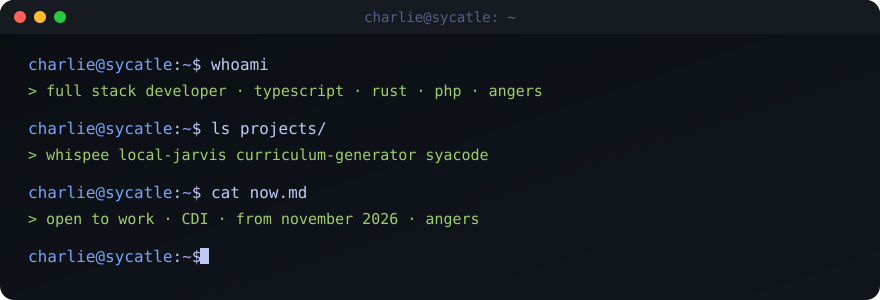

  

> **Charlie Dallier-Wood** — full stack developer (TypeScript, Rust, PHP), based in Angers. I take over existing products, ship them to production with tests and CI, and work with AI agents through documented workflows. **Open to a CDI from November 2026.**

### How I work with AI

Not prompt-by-prompt: a setup I can show.

- **Project instructions** (`CLAUDE.md`) and **architecture decision records** to keep an agent on the rails: 14 ADRs on a client SaaS delivered in 7 weeks.
- **Tests and CI on every change** as the safety net for generated code.
- **MCP servers** I build and use: [hammer-mcp](https://github.com/ProjectSocietyStudio/hammer-mcp) (Source engine maps), [wayland-mcp](https://github.com/kurojs/wayland-mcp) (contribution).
- **Syacode**: [my fork of OpenCode](https://github.com/Sycatle/opencode) tuned for token cost (-47% on tool definitions, -52% on the skills list, prompt cache preserved).

### Projects

- **[whispee](https://github.com/Sycatle/whispee)** — end-to-end encrypted messenger on MLS (RFC 9420). Rust core compiled to WebAssembly, Axum server, React client. A learning project.
- **[local-jarvis](https://github.com/Sycatle/local-jarvis)** — 100% local voice assistant for Linux (Rust, systemd, D-Bus, Whisper, Qwen2.5, Kokoro).
- **[curriculum-generator](https://github.com/Sycatle/curriculum-generator)** — self-hosted CV builder with live PDF preview, an ATS score and DOCX export.
- **[asap-website-builder](https://github.com/Sycatle/asap-website-builder)** — ship a professional website in minutes. Self-hostable.
- **[deviso.pro](https://deviso.pro)** — quoting and invoicing SaaS for landscapers.

### Open source contributions

- **[obscura](https://github.com/h4ckf0r0day/obscura)** (28k+ stars) — 3 merged PRs, including a V8 abort fix under concurrent CDP connections.
- **[gmod-glide](https://github.com/StyledStrike/gmod-glide)** — 4 merged PRs.
- **[wayland-mcp](https://github.com/kurojs/wayland-mcp)** — merged PR: capability-based backend selection and COSMIC support.

**Stack** — TypeScript · React · Next.js · React Native · PHP · Rust (Axum) · PostgreSQL · Docker · GitHub Actions · Playwright · Vitest · Claude Code · MCP

[LinkedIn](https://www.linkedin.com/in/charliedallierwood/) · [charlie.dallier-wood@pm.me](mailto:charlie.dallier-wood@pm.me) · [Case studies](https://sycode.fr/case-studies)
